# MIRASET Chain implementation plan

**Status:** Normative execution sequence; requirements and architecture gates are pending.
**Traceability:** `miraset-chain-hardening`
**Scope:** Public Rust protocol and node implementation only.

This plan defines the order, prerequisites, and evidence required to implement
the requested experimental permissioned chain. It does not claim that any
feature, gate, test, or approval is complete. A phase may start only when its
entry criteria are met; a phase is complete only when its exit evidence is
reviewed and recorded.

## 1. Governing constraints

1. **Resolve the settlement decision before implementation.** Protocol
   ADR-0013 remains Accepted and selects Sui for Phase 1–3. Protocol ADR-0016
   requests a self-hosted HotStuff network but remains Proposed. Until a
   successor decision is explicitly accepted, any HotStuff work MUST remain
   isolated experimental/devnet work and MUST NOT be described or activated as
   canonical production settlement.
2. **Reconcile the implementation baseline.** The inspected checkout is a
   dependency-free Rust 2024 binary whose `src/main.rs` only prints
   `Hello, world!`. The vault's engineering summary describes a substantially
   different implementation at revision `a6d48f1`. The maintainer MUST
   identify the intended repository/ref and reconcile that difference before
   selecting code to port, retain, or replace.
3. **Use original decisions as engineering constraints.** Obtain and read the
   original engineering ADR-0001 and ADR-0002 at the intended revision before
   changing transaction/input handling, execution, persistence, or recovery.
   The vault summary is navigation, not a substitute for those records.
   Preserve the accepted constraints: prompts stay outside signed and durable
   chain state; candidate execution is atomically committed, flushed before
   publication, and validated/replayed on recovery.
4. **Do not invent protocol or economic rules.** Source conflicts, missing
   acceptance records, or unresolved requirements block the affected
   implementation. In particular, do not infer HotStuff validator rewards
   from PoCC rewards, or infer correct inference/payment from a receipt hash.
5. **Keep the public/private boundary.** Implement only approved chain
   protocol, cryptography, execution, consensus, persistence, transport, node
   RPC, tests, and their public documentation. Do not add product applications,
   worker/inference code, payment integrations, customer credit ledgers,
   prompts, or private product data. Do not change repository visibility or
   deploy without separate authorization.
6. **Apply the selected Hexagonal direction only after approval.** Keep
   deterministic protocol and state-transition code independent of runtime,
   database, RPC, and transport libraries. Place I/O behind explicit ports and
   adapters; keep mutable consensus and execution state single-owner and
   communicate through bounded messages. The proposed crate layout in
   `ARCHITECTURE.md` is a candidate until the Architecture Gate approves it.
7. **Do not claim acceptance from a compile or smoke test.** Every requirement
   must map to source, implementation, and recorded acceptance evidence.
   Preserve failed evidence and reproducible fault cases.

## 2. Phase and gate sequence

```mermaid
flowchart LR
  G0["G0: baseline and sources"] --> G1["G1: requirements and architecture"]
  G1 --> P2["P2: protocol and deterministic execution"]
  P2 --> P3["P3: atomic persistence and recovery"]
  P3 --> P4["P4: restart-safe HotStuff"]
  P4 --> P5["P5: membership, sync, network, RPC"]
  P5 --> P6["P6: operations and fault qualification"]
  P6 --> G2["G2: independent reviews and release decision"]
```



The sequence is a dependency order, not a delivery-date promise. Tests,
bounded-resource handling, contextual errors, and secret-safe observability
are required within the slice that introduces each behavior; they are not
deferred to the final phase.

### G0 — Baseline and authoritative sources

**Entry:** This plan is approved as the work sequence.

**Work:**

- Record the target repository URL, exact commit/ref, Rust toolchain, worktree
  status, and reproducible baseline build/test results.
- Compare the target code and tests with the inspected starter checkout.
  Identify missing, changed, or untrusted history before porting or replacing
  files.
- Read original engineering ADR-0001 and ADR-0002 from the target revision.
  Read applicable accepted protocol ADRs (including 0004 and 0008), Proposed
  ADR-0016, `SOW.md`, `REWARDS.md`, and the project public/private boundary
  decision. Cross-check reward parameters against
  `finance/simulations/financial_simulator.py` as reference data without
  executing it. Record exact source paths, revision/date, status, applicable
  requirements, and conflicts.
- When the original engineering register is recovered, disposition ADR-0003
  through ADR-0005 (desktop wallet and local services): Accepted
  ADR-PROJECT-0001 places that scope in private repositories, so those records
  must be preserved as history and marked out of public scope or superseded —
  not silently dropped or re-implemented here.
- Reconcile the requested HotStuff scope with accepted ADR-0013. Obtain an
  explicit protocol/maintainer decision to either (a) continue only as
  experimental/devnet software, or (b) accept a successor protocol decision
  before any production-settlement claim or activation.
- Replace stale source-gap statements in the requirements baseline only when
  each fact is verified; retain unavailable items as explicit blockers.

**Exit evidence (AT01):** Reviewed baseline commit/ref; source matrix with
original engineering ADRs and protocol status; written settlement-scope
disposition; requirements conflicts and missing inputs assigned to owners.

**Stop condition:** Do not start implementation if the target checkout or
original engineering ADRs cannot be obtained, or if the requested behavior
cannot be reconciled with the accepted protocol boundary. Continue only
independent documentation and test-design work.

### G1 — Requirements and architecture approval

**Entry:** G0 exit evidence is complete.

**Work:**

- Map every PRD requirement R01–R13 to an authoritative source/status, design
  decision, implementation slice, and acceptance test AT01–AT13. Mark
  unverified claims as unverified; do not silently promote Proposed records.
- Resolve all blocking contracts before the affected code is written:
  consensus variant and exact safety/commit rules; committee and quorum model;
  genesis, chain identity and upgrade authority; signing purposes and key
  custody; canonical encoding and versioning; timestamp and epoch semantics;
  economics and fixed-point rounding; atomic storage and uncertain-write
  recovery; membership activation; authenticated network limits; RPC
  admission/query semantics; and shutdown/readiness behavior.
- Verify the applicable scope of accepted crypto ADR-0008. Do not introduce
  BLS into HotStuff merely because that ADR mentions validator aggregate
  signatures for epoch attestations.
- Review library candidates for exact protocol fit, maintenance, licensing,
  failure semantics, portability, and resource bounds before adding
  dependencies. Record selected versions and rationale in the approved design.
- Reconcile this repository's own licensing before any publication: `LICENSE`
  is MIT while `package.json` declares ISC and `Cargo.toml` declares none.
  Accepted ADR-PROJECT-0001 requires resolving license selection and
  republication rights before creating the public blockchain repository.
- Approve crate/module boundaries, port signatures, ownership, cancellation,
  durability and error contracts. Keep the candidate workspace small; split
  code only where dependency boundaries or independent consumers require it.
- Obtain the required independent Requirement and human Architecture gates.
  Record reviewer identity/role, decision, date, and any conditions in the
  project’s approved decision record; do not invent or overwrite ADR numbers.

**Exit evidence:** Requirement traceability matrix; resolved or explicitly
deferred decision register; approved architecture/port contracts; dependency
and license record; recorded gate outcomes.

**Stop condition:** No consensus, recovery, membership, cryptography, or
settlement implementation while its requirements, algorithm, or architecture
approval is unresolved. A TODO, stub, or default value is not a resolution.

## 3. Implementation slices

Each slice MUST be delivered as a reviewable change with focused tests,
updated requirement traceability, exact validation commands/results, and no
unrelated product scope. A failed exit criterion returns the slice to
implementation; it does not advance by waiver or by later-slice evidence.

| Slice | Prerequisites | Scope | Required exit evidence |
|---|---|---|---|
| **P2 — Canonical protocol and deterministic execution** | G1; approved encoding, transaction/block/receipt schemas, execution rules, economics and epoch order | Implement versioned canonical data and commitments; validate authorization, replay, timestamps and limits; execute synchronously against candidate state using checked integer/fixed-point arithmetic; keep prompts and private inference inputs out of signed/durable records. | AT03, AT04, AT13 unit/golden/property tests; stable golden bytes and roots; invalid inputs rejected without candidate-state mutation; independent replay produces identical results. |
| **P3 — Atomic persistence and recovery** | P2; accepted engineering ADR-0002 reviewed; approved storage and durability contract | Persist application records and versioned recovery metadata atomically; flush before publication; validate chain/genesis identity, schema, height/ancestry and commitments during recovery; fail closed on corruption or uncertain completion. | AT05 crash injection at every write/flush/publication boundary; durable acknowledged commits recover; uncommitted results are never published; corrupt/incomplete history is rejected. |
| **P4 — Restart-safe HotStuff** | P3; reviewed, internally consistent HotStuff variant, quorum, ancestry, vote/lock, certificate, commit, view-change and pacemaker specification | Implement proposals, authenticated votes/certificates, ancestry checks, safe-vote and lock predicates, timeout/view change, and durable safety state. Persist required safety state before emitting a vote. Do not substitute Raft or treat a QC as finality without the specified commit rule. | AT06, AT07 deterministic adversarial simulations; within the approved fault bound no two honest validators finalize conflicting blocks; crash/restart cannot produce conflicting same-view votes; progress tests state scheduler/fairness assumptions and bounded scenario windows. |
| **P5a — Fixed committee and membership controls** | P4; approved genesis/authorization policy and activation boundary | Start with a fixed authorized genesis committee. Reject unauthorized membership changes. Keep peer connectivity separate from validator authority. Implement reconfiguration only after its old/new committee proof, activation, bootstrap, state-transfer, and quorum-safety contract is approved. | AT08 unauthorized-change and activation tests; peer-list changes cannot alter membership; if reconfiguration is implemented, test safety and catch-up across the transition. Otherwise, document it as unsupported and fail closed. |
| **P5b — Authenticated bounded network and history sync** | P4; P5a fixed-committee identity rules; approved wire protocol, authentication and limits | Implement authenticated versioned messages; bound bytes, queues, concurrent peers, pending work, and verification; synchronize only validated finalized history with required ancestry/proofs; validate snapshots against an authenticated checkpoint and state root. | AT09, AT10 malformed/replayed/stale/unauthorized/overload tests; configured bounds are enforced; forged finality, incomplete ancestry, corrupt snapshots and unsupported schemas fail closed. |
| **P5c — Public node RPC and projections** | P2–P5b; approved API, authentication and rate limits | Implement versioned authenticated admission and finalized queries; distinguish rejected, admitted, and finalized results; expose finalized height/root and projection height/freshness; prevent RPC or projections from authorizing transitions. | AT11 admission is not represented as finality; replay cannot double-settle; stale projections are explicitly identified; limits and authorization are tested. |
| **P6 — Operational qualification** | P2–P5c; deployable experimental profile and documented configuration | Protect signing keys; validate configuration before startup; recover before voting/readiness; expose health separately from quorum/readiness; add secret-safe tracing and bounded-cardinality metrics; implement bounded shutdown and explicit failure on uncertain persistence. Build a reproducible multiprocess fault harness. | AT02, AT12 plus applicable AT05–AT10 real process-failure scenarios; no production-mode activation; restart and shutdown preserve recovery guarantees; logs contain no secrets/private inputs; measured resource bounds and fault evidence are recorded. |

## 4. Verification and evidence

1. **Before each slice:** run the existing baseline checks and focused tests;
   record the target revision, toolchain, command, and result. Do not use the
   placeholder Node test script as Rust validation.
2. **During each slice:** add built-in Rust unit/integration tests alongside
   behavior. Use golden vectors for canonical bytes; reproducible seeds and
   shrinking for property tests; explicit fault schedules for simulation and
   storage tests. A happy-path run is smoke coverage only.
3. **After each slice:** run focused tests, then the applicable formatting,
   clippy, and package/workspace checks:

   ```sh
   cargo fmt --check
   cargo clippy --workspace --all-targets -- -D warnings
   cargo test --workspace
   ```

   Until a workspace exists, use the corresponding package-level Cargo
   commands without `--workspace`. Record exact commands and exit codes.
4. **Fault evidence:** include acceptance ID, revision, toolchain, seed/config,
   fault schedule, expected invariant, result, finalized height/root, and
   resource measurements where applicable. Keep a minimal reproducer for each
   failure.
5. **Coverage claim:** report only measured coverage from configured tooling.
   Coverage does not replace consensus safety, economic invariant, recovery,
   resource-bound, or independent-review evidence.

`docs/stories/miraset-chain-tests.md` defines the acceptance assertions. It
remains a test design until those tests are implemented and executed.

## 5. Final review and release gate

The implementation author MUST NOT self-approve the required independent
quality gates. Before any release or production claim:

- Requirement traceability and all applicable AT01–AT13 evidence are reviewed
  by independent QA, security, code-review, and audit roles.
- Human Security and Code Review approvals are recorded; human Architecture
  approval remains required for high-risk design changes.
- All unresolved findings, unsupported features, and deviations from approved
  decisions are recorded with owners and disposition. No critical/high issue,
  safety invariant, data-integrity guarantee, or privacy boundary is waived by
  this plan.
- Experimental/devnet labeling and activation controls are verified. Changing
  protocol acceptance, repository visibility, or deployment state requires its
  own explicit authorization.

The configured specialist SDLC roles are not currently available in this
session. Their gates are therefore **not passed** by writing this plan or by
the implementation author’s own checks. Work that requires those gates remains
blocked until the roles and required human approvals are available.

## 6. Explicitly out of scope

- Production settlement on HotStuff before protocol ADR-0016 is accepted and
  the accepted ADR-0013 boundary is formally resolved.
- Private worker, inference, wallet/product UI, payment-provider, customer
  credit, or product orchestration implementation.
- Claims that receipt commitments prove correct inference, that TLS authorizes
  validators, or that successful compilation demonstrates consensus safety.
- Validator reconfiguration, BLS aggregation for HotStuff, or throughput and
  latency guarantees without approved contracts and measured evidence.
- Deployment, repository visibility changes, or publication of private data.
